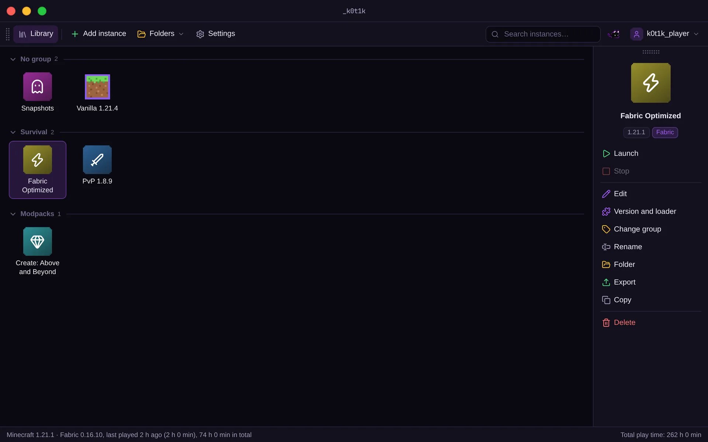
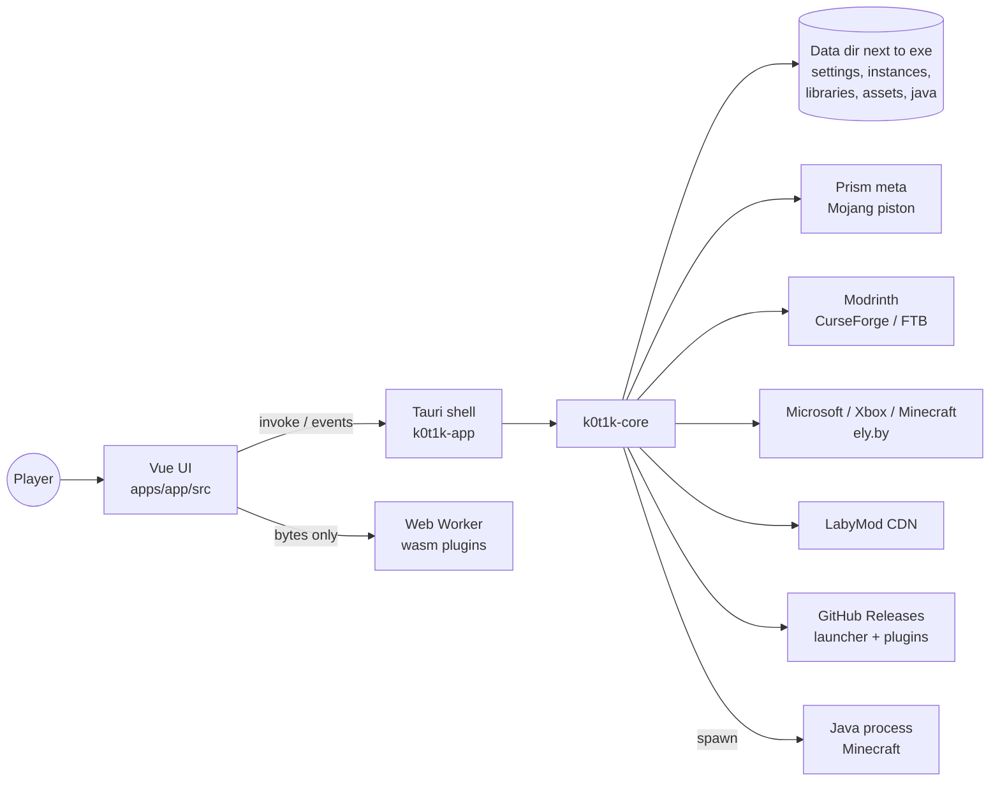
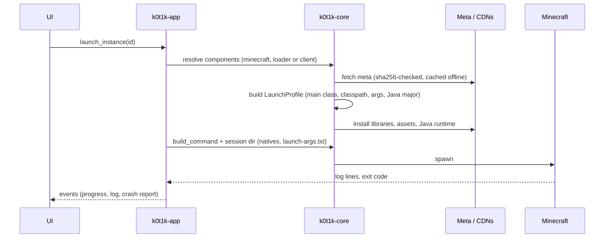

<div align="center">


<h1>_k0t1k — Minecraft Launcher</h1>
<hr>

**A Minecraft launcher in one place: Prism-style instances, portable data, Ed25519-signed self-updates**


[](https://github.com/hhhhhffd/_k0t1k/actions/workflows/pages.yml)
[](https://github.com/hhhhhffd/_k0t1k/releases/latest)
[](LICENSE)

[Download](https://github.com/hhhhhffd/_k0t1k/releases/latest) · [Website](https://hhhhhffd.github.io/_k0t1k/) · [Architecture](#architecture-deep-dive) · [Build](#setup--deployment) · [Discord](https://discord.gg/zxnMAfUvJ)

English · [Русский](README.ru.md)

</div>

## What it is

_k0t1k is a Minecraft Java launcher that aims for Prism Launcher's feature set with a custom UI. A Rust core owns
every launcher concern (metadata, installs, Java, accounts, content, launching); a thin Tauri 2 shell exposes it to
a Vue 3 UI. It targets Windows first and also ships a Linux AppImage. It is in open beta.



## Highlights

- Rust core of about 21.7K lines and a Tauri 2 shell with 106 typed IPC commands covering instances,
  Microsoft and ely.by accounts, and Modrinth, CurseForge and FTB content.
- 318 tests; 5 public releases.
- Ed25519-signed self-updates with rollback, hash-verified atomic downloads, DPAPI-encrypted account tokens.
- Optional features run as signed WebAssembly plugins in a sandboxed Web Worker. One of them embeds the RatScan
  mod-malware scanner, built from [hhhhhffd/ratka_checker](https://github.com/hhhhhffd/ratka_checker).

**Role:** sole developer; AI-assisted development.

| Area | What it does |
|---|---|
| Content | Modrinth and CurseForge mods, modpacks and resource packs, FTB packs, managed pack updates, update-all, drag & drop |
| Loaders and clients | Fabric, Quilt, Forge, NeoForge through Prism meta; LabyMod 4 as an alternative client |
| Java | Mojang runtimes downloaded per version, automatic JVM memory tuning |
| Accounts | Microsoft (device code), ely.by, offline; tokens encrypted with DPAPI |
| Instances | Groups, copies, custom icons, playtime, worlds, data packs, screenshots, shared `servers.dat` |
| Import and export | Prism zip, `.mrpack`, CurseForge zip |
| Diagnostics | Crash dialog with one-click log upload to mclo.gs |
| UI | Themes, user themes, lite mode, English and Russian |

## Technical Stack

| Group | Technology | Version | Role |
|---|---|---|---|
| Core | Rust (`packages/core`, crate `k0t1k-core`) | edition 2024 | Launcher logic with no UI dependency, tested on Linux |
| Core | tokio / reqwest (rustls) | 1.54 / 0.13 | Async runtime and HTTP |
| Shell | Tauri (`apps/app/src-tauri`, crate `k0t1k-app`) | 2.12 | Window, tray, commands, events, WebView2 |
| UI | Vue + Pinia + vue-router | 3.5 / 4.1 / 5.4 | Views and state |
| UI | TypeScript, Vite, Tailwind CSS | 5.9 / 8.3 / 4.3 | Build and styling |
| Plugins | WebAssembly (wasm-bindgen, `--target web`) | api v1 | RatScan and packconv, run in a Web Worker |
| Data | JSON files (`settings.json`, `instance.json`), packwiz `.pw.toml` | — | Storage, Prism-compatible mod metadata |
| Infra | GitHub Releases, GitHub Pages (`site/`) | — | Signed exe and plugin releases, landing page |

## Architecture Deep Dive

### System diagram



### Launch pipeline



### Architecture decisions

- **Prism meta as the metadata source.** It is pre-normalised and starts modern Forge/NeoForge through ForgeWrapper,
  so the launcher never runs loader installers. Responses are cached and validated against the parent index's sha256.
- **Clients are components, not mods.** A client (LabyMod 4) is an instance component with a launcher-owned uid.
  Its provider resolves to a version file that replaces the vanilla patch, and it is exclusive with loaders.
- **Plugins run in a Web Worker.** RatScan and packconv are wasm-bindgen builds verified against a separate
  Ed25519 key. The worker has no Tauri IPC, so a plugin only sees the bytes it is given. Bundled baselines keep
  them working offline.
- **Signed self-update without an installer.** The signature covers `version + sha256(exe)`, which blocks replay
  and downgrade. The running exe is renamed to `.old` and the new one is started with `--wait-for <pid>`, so the
  single-instance mutex is free.

Full notes: [docs/ARCHITECTURE.md](docs/ARCHITECTURE.md).

## Project Structure

```text
.
├── apps/app/src            # Vue UI: views, components, stores, i18n (en, ru), wasm plugin host
├── apps/app/src-tauri      # Tauri shell: commands, tray, window, updater, plugin backend
├── apps/app/public/plugins # Bundled baseline builds of the wasm plugins
├── packages/core           # k0t1k-core: meta, install, java, auth, content, launch, update, plugins
├── icons                   # Instance icon set (SVG) and its style guide
├── site                    # Landing page, deployed to GitHub Pages
├── scripts                 # release.sh: sign and publish a launcher release
└── docs                    # ARCHITECTURE.md
```

## Setup & Deployment

### Use the launcher

1. Download `_k0t1k.exe` (Windows) or `_k0t1k-x86_64.AppImage` (Linux) from [Releases](https://github.com/hhhhhffd/_k0t1k/releases/latest).
2. Put it in any folder. On Windows its data is stored next to it.
3. Start it, sign in, create an instance and press Play.

> [!NOTE]
> Windows: 10 or newer with WebView2; the exe is not code-signed yet, so SmartScreen may warn on first start.
> Linux: x86_64 AppImage for Ubuntu 22.04 or newer and similar systems; make it executable and run it. There is no tray icon on Linux.

### Build from source

Requirements: Rust (edition 2024), Node.js with pnpm, and Windows for the Tauri app. The Tauri crate does not build
on Linux without webkit2gtk, but `k0t1k-core` builds and tests anywhere.

```bash
pnpm install
cargo test -p k0t1k-core          # core tests, any OS
pnpm --filter @k0t1k/app check    # vue-tsc
pnpm dev                          # tauri dev
```

Release build on Windows:

```bash
pnpm --filter @k0t1k/app exec vite build
cargo build --release -p k0t1k-app --features tauri/custom-protocol
```

Build-time keys are read from `.env` in the repository root by `apps/app/src-tauri/build.rs`. Each one is optional.

| Variable | Default | Without it |
|---|---|---|
| `K0T1K_CURSEFORGE_API_KEY` | _unset_ | CurseForge is unavailable |
| `K0T1K_MSA_CLIENT_ID` | _unset_ | Microsoft sign-in is unavailable |
| `K0T1K_DISCORD_CLIENT_ID` | _unset_ | Discord Rich Presence is off |

> [!WARNING]
> `.env` is git-ignored. CurseForge keys start with `$2a$10$`, so never `source` the file in a shell.

<details>
<summary>Publishing a release</summary>

`scripts/release.sh <exe> <notes>` reads the version from the workspace `Cargo.toml` and checks that the exe embeds it.
It signs `"_k0t1k-update\n" + version + "\n" + sha256(exe)` with the key in `K0T1K_UPDATE_KEY`
(default `~/.config/k0t1k/update-signing-key.pem`). It refuses a dirty or unpushed tree, then runs
`gh release create v<version>` with `_k0t1k.exe` and `_k0t1k.exe.sig`. Bump the version in `Cargo.toml` and
`apps/app/package.json` before each release.

</details>

## Links

| Item | Link |
|---|---|
| Website | https://hhhhhffd.github.io/_k0t1k/ |
| Releases | https://github.com/hhhhhffd/_k0t1k/releases |
| Support / bug reports | https://discord.gg/zxnMAfUvJ |

## License

AGPL-3.0-only. See [LICENSE](LICENSE). Copyright (c) 2026 hhhhhffd.
