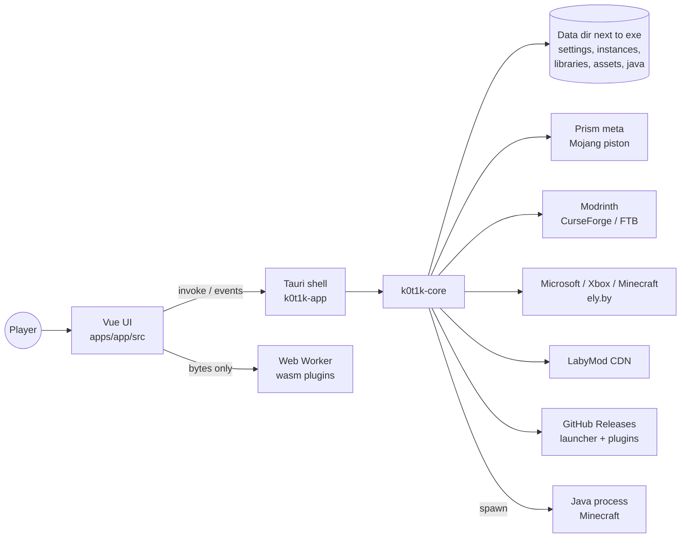
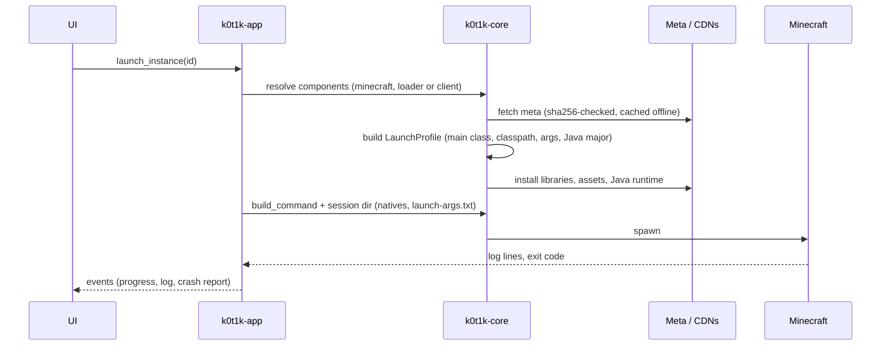

<div align="center">


<h1>_k0t1k — Minecraft Launcher</h1>
<hr>

**Лаунчер Minecraft в одном месте: сборки в стиле Prism, портативные данные, самообновление с подписью Ed25519**


[](https://github.com/hhhhhffd/_k0t1k/actions/workflows/pages.yml)
[](https://github.com/hhhhhffd/_k0t1k/releases/latest)
[](LICENSE)

[Скачать](https://github.com/hhhhhffd/_k0t1k/releases/latest) · [Сайт](https://hhhhhffd.github.io/_k0t1k/) · [Архитектура](#архитектура) · [Сборка](#установка-и-сборка) · [Discord](https://discord.gg/zxnMAfUvJ)

[English](README.md) · Русский

</div>

## Что это

_k0t1k — лаунчер Minecraft Java с набором возможностей Prism Launcher и собственным интерфейсом. Ядро на Rust
отвечает за все задачи лаунчера (метаданные, установка, Java, аккаунты, контент, запуск), тонкая оболочка Tauri 2
отдаёт его интерфейсу на Vue 3. Основная платформа — Windows, для Linux есть AppImage. Сейчас открытая бета.


## Главное

- Ядро на Rust (около 21,7 тыс. строк) и оболочка Tauri 2 со 106 типизированными IPC-командами: сборки,
  аккаунты Microsoft и ely.by, контент Modrinth, CurseForge и FTB.
- 318 тестов; 5 публичных релизов.
- Самообновление с подписью Ed25519 и откатом, атомарные загрузки с проверкой хэша, токены аккаунтов шифруются через DPAPI.
- Необязательные функции работают как подписанные плагины WebAssembly в изолированном Web Worker. Один из них
  содержит сканер вредоносных модов RatScan, собранный из [hhhhhffd/ratka_checker](https://github.com/hhhhhffd/ratka_checker).

**Роль:** единственный разработчик; разработка с помощью ИИ.

| Область | Что умеет |
|---|---|
| Контент | Моды, сборки и ресурспаки Modrinth и CurseForge, сборки FTB, обновление сборок, update-all, drag & drop |
| Загрузчики и клиенты | Fabric, Quilt, Forge, NeoForge через Prism meta; LabyMod 4 как альтернативный клиент |
| Java | Рантаймы Mojang под каждую версию, автоматическая настройка памяти JVM |
| Аккаунты | Microsoft (device code), ely.by, офлайн; токены шифруются через DPAPI |
| Сборки | Группы, копии, свои иконки, время игры, миры, датапаки, скриншоты, общий `servers.dat` |
| Импорт и экспорт | Prism zip, `.mrpack`, zip CurseForge |
| Диагностика | Окно краша с загрузкой лога на mclo.gs в один клик |
| Интерфейс | Темы, пользовательские темы, lite-режим, английский и русский |

## Технологии

| Группа | Технология | Версия | Роль |
|---|---|---|---|
| Ядро | Rust (`packages/core`, крейт `k0t1k-core`) | edition 2024 | Логика лаунчера без зависимости от UI, тестируется на Linux |
| Ядро | tokio / reqwest (rustls) | 1.54 / 0.13 | Асинхронный рантайм и HTTP |
| Оболочка | Tauri (`apps/app/src-tauri`, крейт `k0t1k-app`) | 2.12 | Окно, трей, команды, события, WebView2 |
| UI | Vue + Pinia + vue-router | 3.5 / 4.1 / 5.4 | Экраны и состояние |
| UI | TypeScript, Vite, Tailwind CSS | 5.9 / 8.3 / 4.3 | Сборка и стили |
| Плагины | WebAssembly (wasm-bindgen, `--target web`) | api v1 | RatScan и packconv, работают в Web Worker |
| Данные | JSON-файлы (`settings.json`, `instance.json`), packwiz `.pw.toml` | — | Хранение, метаданные модов, совместимые с Prism |
| Инфраструктура | GitHub Releases, GitHub Pages (`site/`) | — | Подписанные релизы лаунчера и плагинов, лендинг |

## Архитектура

### Общая схема



### Запуск игры



### Архитектурные решения

- **Prism meta как источник метаданных.** Данные уже нормализованы, а современные Forge/NeoForge запускаются через
  ForgeWrapper, поэтому лаунчер не запускает установщики загрузчиков. Ответы кэшируются и сверяются с sha256 из
  родительского индекса.
- **Клиенты — это компоненты, а не моды.** Клиент (LabyMod 4) — компонент сборки с собственным uid. Его провайдер
  отдаёт файл версии, заменяющий ванильный патч; с загрузчиками клиент несовместим.
- **Плагины работают в Web Worker.** RatScan и packconv — сборки wasm-bindgen, проверяемые отдельным ключом
  Ed25519. У воркера нет Tauri IPC, поэтому плагин видит только переданные ему байты. Встроенные копии позволяют
  работать без сети.
- **Подписанное самообновление без установщика.** Подпись покрывает `version + sha256(exe)`, что исключает повтор
  и откат версии. Запущенный exe переименовывается в `.old`, новый стартует с `--wait-for <pid>`, поэтому мьютекс
  единственного экземпляра свободен.

Подробнее: [docs/ARCHITECTURE.md](docs/ARCHITECTURE.md).

## Структура проекта

```text
.
├── apps/app/src            # Vue UI: экраны, компоненты, сторы, i18n (en, ru), хост wasm-плагинов
├── apps/app/src-tauri      # Оболочка Tauri: команды, трей, окно, обновление, бэкенд плагинов
├── apps/app/public/plugins # Встроенные базовые сборки wasm-плагинов
├── packages/core           # k0t1k-core: meta, install, java, auth, content, launch, update, plugins
├── icons                   # Набор иконок сборок (SVG) и гайд по стилю
├── site                    # Лендинг, публикуется на GitHub Pages
├── scripts                 # release.sh: подпись и публикация релиза лаунчера
└── docs                    # ARCHITECTURE.md
```

## Установка и сборка

### Использование

1. Скачайте `_k0t1k.exe` (Windows) или `_k0t1k-x86_64.AppImage` (Linux) из [Releases](https://github.com/hhhhhffd/_k0t1k/releases/latest).
2. Положите файл в любую папку. В Windows данные хранятся рядом с ним.
3. Запустите, войдите в аккаунт, создайте сборку и нажмите Play.

> [!NOTE]
> Windows: 10 или новее с WebView2; exe пока не подписан сертификатом, поэтому при первом запуске SmartScreen может предупредить.
> Linux: AppImage для x86_64, Ubuntu 22.04 или новее и похожие системы; сделайте файл исполняемым и запустите. Трея в Linux нет.

### Сборка из исходников

Нужны Rust (edition 2024), Node.js с pnpm и Windows для приложения Tauri. Крейт Tauri не собирается на Linux без
webkit2gtk, но `k0t1k-core` собирается и тестируется где угодно.

```bash
pnpm install
cargo test -p k0t1k-core          # тесты ядра, любая ОС
pnpm --filter @k0t1k/app check    # vue-tsc
pnpm dev                          # tauri dev
```

Релизная сборка в Windows:

```bash
pnpm --filter @k0t1k/app exec vite build
cargo build --release -p k0t1k-app --features tauri/custom-protocol
```

Ключи времени сборки читаются из `.env` в корне репозитория через `apps/app/src-tauri/build.rs`. Все они необязательны.

| Переменная | По умолчанию | Без неё |
|---|---|---|
| `K0T1K_CURSEFORGE_API_KEY` | _не задана_ | CurseForge недоступен |
| `K0T1K_MSA_CLIENT_ID` | _не задана_ | Вход через Microsoft недоступен |
| `K0T1K_DISCORD_CLIENT_ID` | _не задана_ | Discord Rich Presence выключен |

> [!WARNING]
> `.env` в git-ignore. Ключи CurseForge начинаются с `$2a$10$`, поэтому не выполняйте `source` для этого файла в shell.

<details>
<summary>Публикация релиза</summary>

`scripts/release.sh <exe> <notes>` берёт версию из `Cargo.toml` воркспейса и проверяет, что она вшита в exe.
Он подписывает `"_k0t1k-update\n" + version + "\n" + sha256(exe)` ключом из `K0T1K_UPDATE_KEY`
(по умолчанию `~/.config/k0t1k/update-signing-key.pem`). Скрипт отказывается работать с грязным или непушнутым деревом,
затем запускает `gh release create v<version>` с `_k0t1k.exe` и `_k0t1k.exe.sig`. Перед каждым релизом поднимайте версию
в `Cargo.toml` и `apps/app/package.json`.

</details>

## Ссылки

| Что | Ссылка |
|---|---|
| Сайт | https://hhhhhffd.github.io/_k0t1k/ |
| Релизы | https://github.com/hhhhhffd/_k0t1k/releases |
| Поддержка и баг-репорты | https://discord.gg/zxnMAfUvJ |

## Лицензия

AGPL-3.0-only. См. [LICENSE](LICENSE). Copyright (c) 2026 hhhhhffd.
